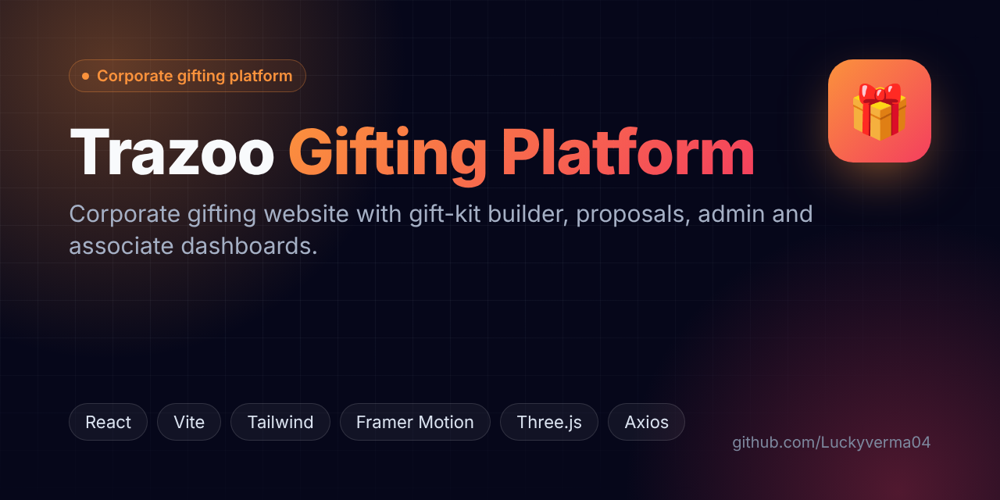
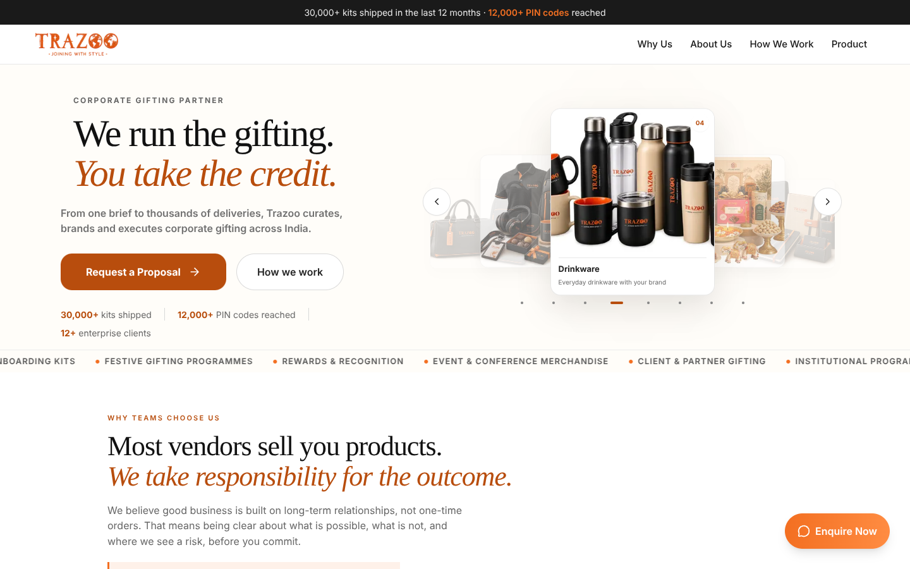
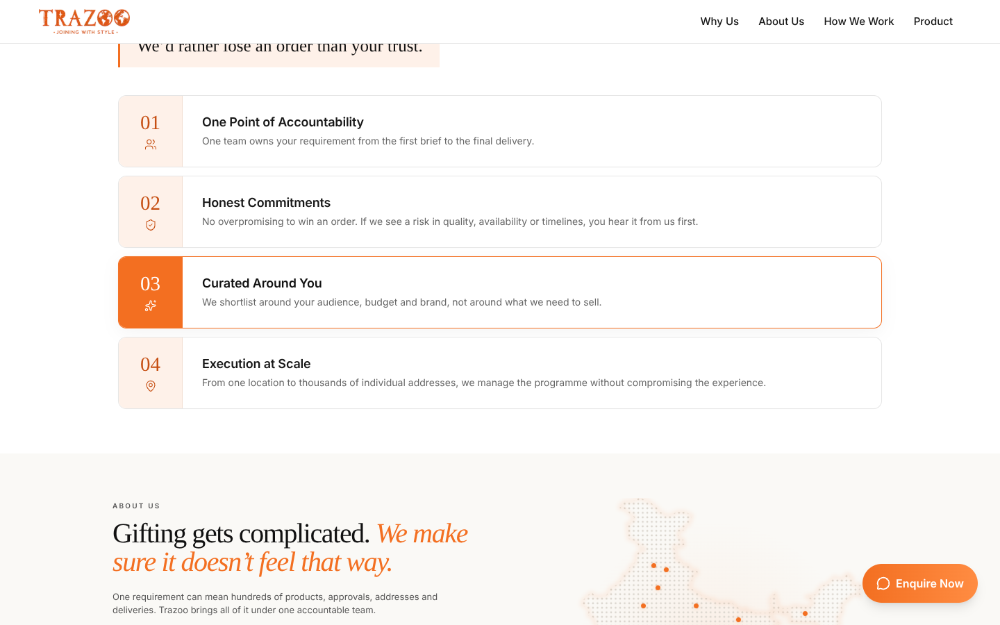
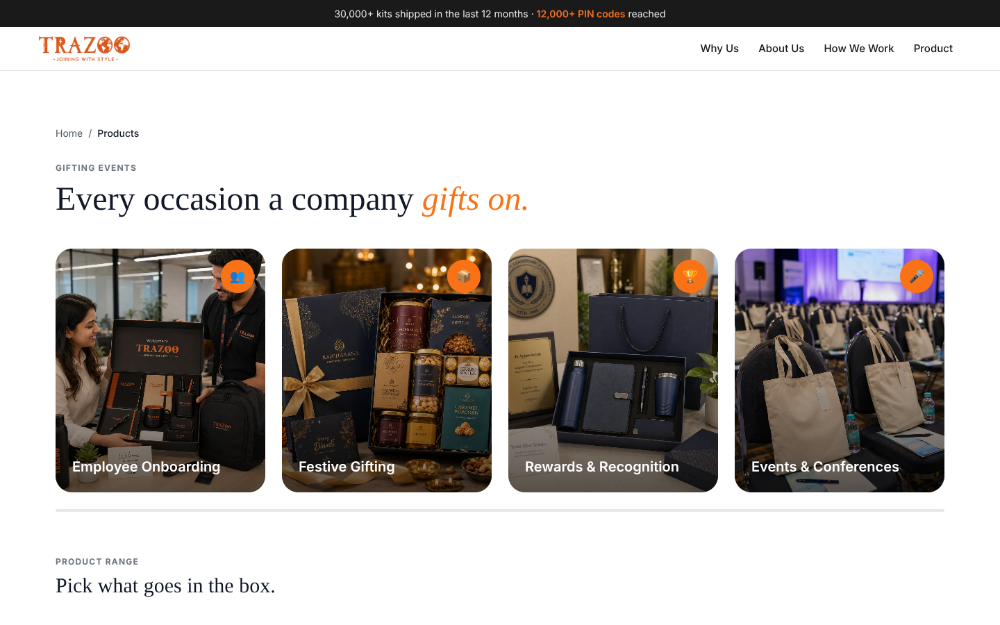
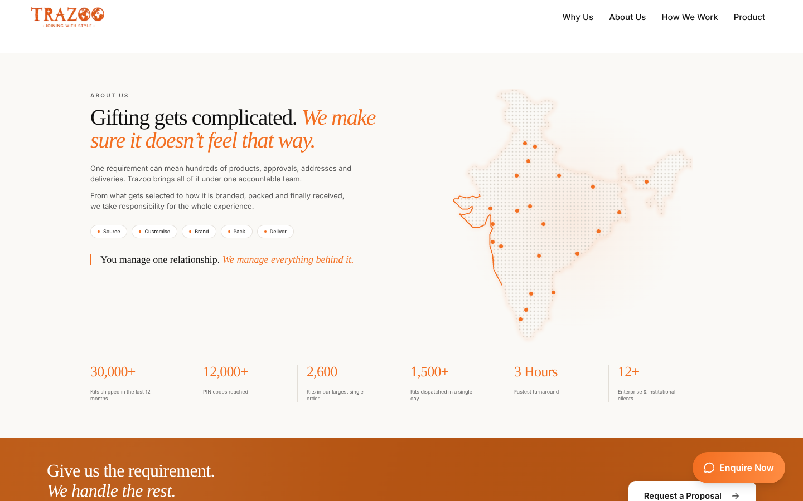
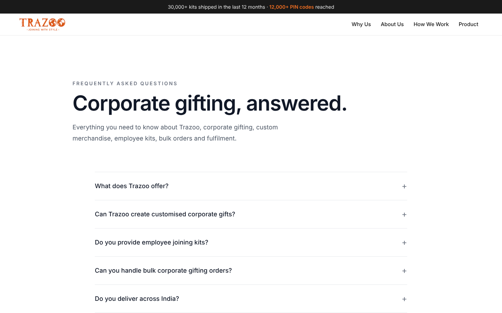
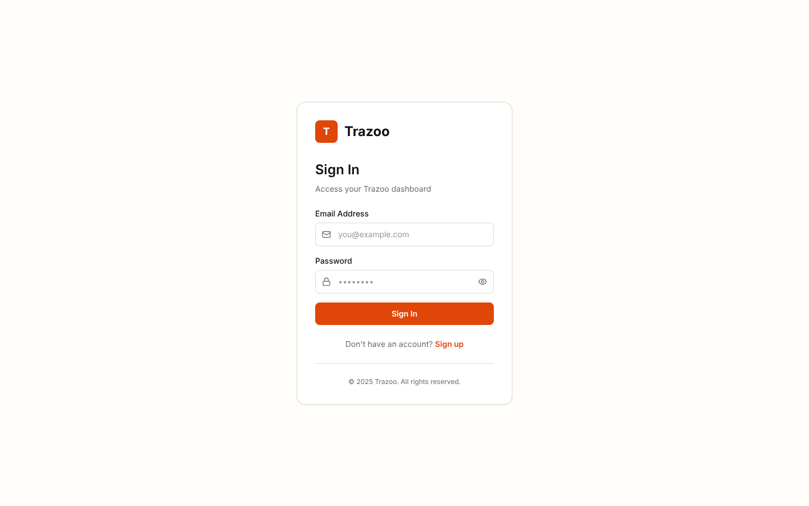
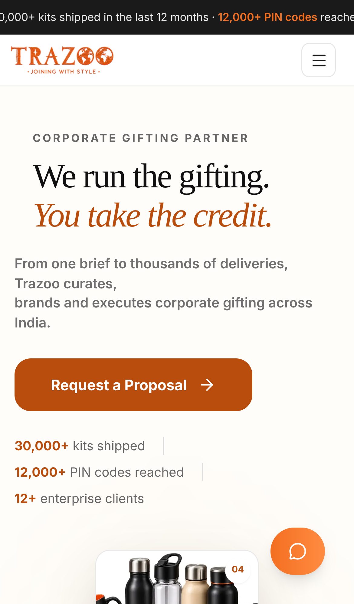

<div align="center">



# 🎁 Trazoo — Corporate Gifting Platform (Frontend)

**"We run the gifting. You take the credit."**
Website and dashboards for Trazoo, a corporate gifting company: product range, gift-kit builder, proposal requests, and admin / associate panels to manage leads.

[🔌 Backend repo](https://github.com/Luckyverma04/Trazoo-products-backend)


</div>

---

## 📸 Screenshots

| Home | Why teams choose us |
|---|---|
|  |  |

| Product range | About |
|---|---|
|  |  |

| FAQ | Sign in | Mobile |
|---|---|---|
|  |  |  |

## ✨ Features

**Public website**
- Landing page with hero, stats (30,000+ kits shipped, 12,000+ PIN codes), process, "why us" and an India reach map
- Product range by occasion: employee onboarding, festive gifting, rewards & recognition, events & conferences, client & partner gifting
- Gift-kit builder: pick categories and a tier (Basic → Luxury) and get a suggested kit and price
- "Request a Proposal" and enquiry forms that create leads in the backend
- FAQ, privacy and terms pages, SEO tags, smooth scrolling and animations

**Admin dashboard** (`/admin/*`)
- Lead overview, lead details and status updates
- Kit enquiries list
- Products manager: add, edit and toggle gift products with images

**Associate dashboard** (`/associate/*`)
- "My leads" assigned by the admin, lead details and call / WhatsApp / email notes

**Auth**: sign up / sign in with email OTP verification.

## 🗺️ Pages

| Route | Page |
|---|---|
| `/` | Landing page |
| `/products` | Product range and gift-kit builder |
| `/about`, `/faq`, `/privacy`, `/terms` | Info pages |
| `/auth`, `/verify-otp` | Sign in / sign up and OTP |
| `/admin/dashboard`, `/admin/lead/:id`, `/admin/products`, `/admin/kit-enquiries` | Admin |
| `/associate`, `/associate/leads`, `/associate/leads/:id` | Associate |

## 🛠️ Tech stack

React · Vite · Tailwind CSS · React Router · Framer Motion · Lenis (smooth scroll) · Three.js / React Three Fiber · Spline · Axios · lucide-react

## 🚀 Run locally

```bash
git clone https://github.com/Luckyverma04/TrazooProductsFrontend.git
cd TrazooProductsFrontend
npm install
npm run dev            # http://localhost:5173
```

### Environment variables

| Key | Description |
|---|---|
| `VITE_API_URL` | Backend URL. Defaults to the deployed Trazoo backend if not set |

### Scripts

| Command | What it does |
|---|---|
| `npm run dev` | Dev server |
| `npm run build` | Production build into `dist/` |
| `npm run preview` | Preview the build |
| `npm run lint` | ESLint |

## 📁 Project structure

```
src/
├── pages/           # Landing, ProductRange, FAQ, Auth, admin/, associate/
├── components/      # Hero, Navbar, Why us, India map, gallery, giftKit/, admin/
├── routes/          # route setup and guards
├── context/ hooks/  # auth and helpers
├── config/          # axios instance (VITE_API_URL)
└── assets/          # product and gallery images
```

---

## 🖼️ Image links

| Image | Link |
|---|---|
| Banner | https://raw.githubusercontent.com/Luckyverma04/TrazooProductsFrontend/main/docs/banner.png |
| Home | https://raw.githubusercontent.com/Luckyverma04/TrazooProductsFrontend/main/docs/screenshots/home.png |
| Why us | https://raw.githubusercontent.com/Luckyverma04/TrazooProductsFrontend/main/docs/screenshots/why-us.png |
| Product range | https://raw.githubusercontent.com/Luckyverma04/TrazooProductsFrontend/main/docs/screenshots/products.png |
| About | https://raw.githubusercontent.com/Luckyverma04/TrazooProductsFrontend/main/docs/screenshots/about.png |
| FAQ | https://raw.githubusercontent.com/Luckyverma04/TrazooProductsFrontend/main/docs/screenshots/faq.png |
| Sign in | https://raw.githubusercontent.com/Luckyverma04/TrazooProductsFrontend/main/docs/screenshots/auth.png |
| Mobile | https://raw.githubusercontent.com/Luckyverma04/TrazooProductsFrontend/main/docs/screenshots/mobile.png |

<div align="center">

Built by **[Lucky Verma](https://github.com/Luckyverma04)**

</div>
